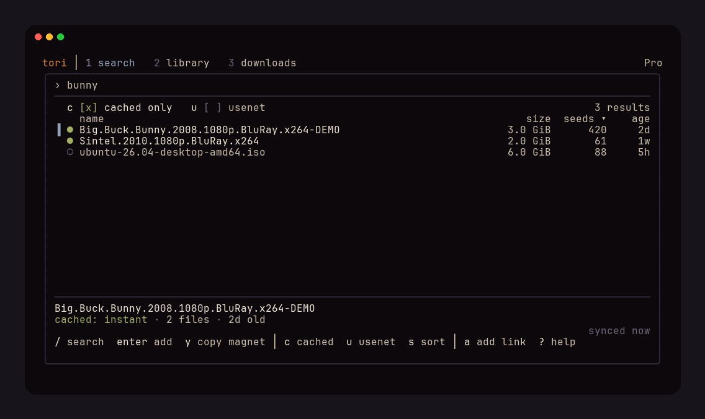
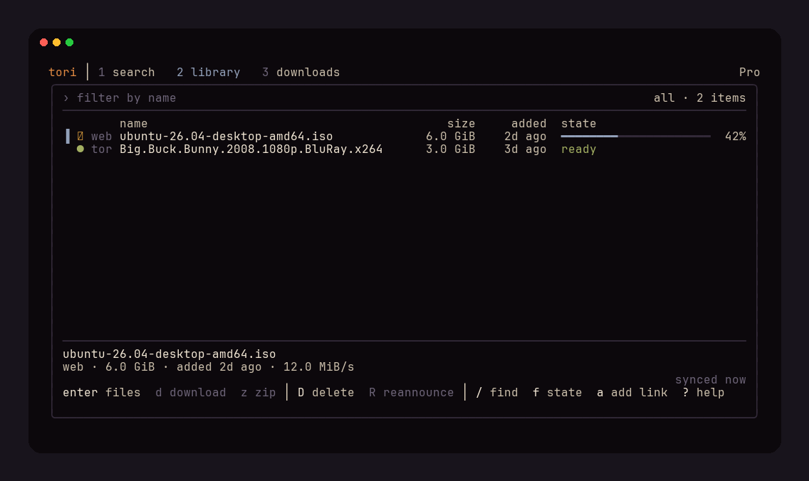
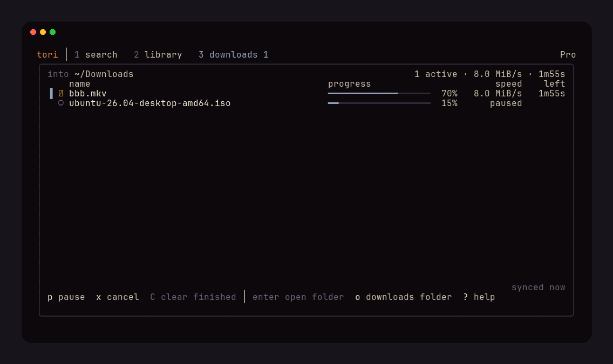
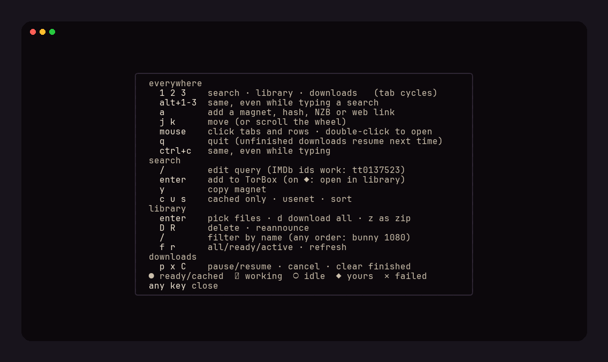

# Tori

A terminal UI for [TorBox](https://torbox.app): search for torrents, manage
what's in your TorBox account, and download files.

Native Omarchy theming supported.

> **Search is down for now.** TorBox's Search API (`search-api.torbox.app`)
> has not answered since early September 2026, and TorBox has not said
> whether it is coming back. The Search tab shows an error until it does;
> the library, adding links (`a`) and downloads all work as normal. If the
> API moves, point `search_url` in the config at the new host.

Tori is an unofficial client, not made or endorsed by TorBox.

## Screenshots









## Install

Tori uses `aria2c` to manage downloads (`sudo pacman -S aria2`, `apt install aria2`, `brew install aria2`).

**Prebuilt binary** (Linux amd64/arm64, macOS arm64), checksum-verified, into `~/.local/bin`:

```
curl -fsSL https://raw.githubusercontent.com/gaius-codius/tori/main/install.sh | sh
```

**With Go** (1.25+):

```
go install github.com/gaius-codius/tori/cmd/tori@latest
```

**From source**:

```
git clone https://github.com/gaius-codius/tori && cd tori
make install          # builds and installs to ~/.local/bin (PREFIX=/usr/local to change)
```

## Update and uninstall

| Installed with | Update | Uninstall |
|---|---|---|
| install script | `tori update` (or re-run the script) | `sh install.sh --uninstall` or `rm ~/.local/bin/tori` |
| `go install` | re-run `go install …@latest` | `rm $(go env GOPATH)/bin/tori` |
| source | `git pull && make install` | `make uninstall` |

`tori update` downloads the latest release for your platform, checks it
against the release's `SHA256SUMS.txt`, and replaces the binary in place.
`tori version` prints the installed version. Uninstalling leaves the config
and the keyring entry in place; run `tori forget-key` first to remove the key.

## Run

```
tori                   # start the TUI
tori add <link>        # add a magnet, info hash, NZB URL or web link without the TUI
tori update            # update to the latest release
tori version           # print the version
tori forget-key        # remove the API key from the keyring
```

On first run tori asks for your API key (torbox.app → Settings → API), checks
it, and stores it in libsecret. `TORBOX_API_KEY` overrides the keyring.

## Tabs

1. **Search**: TorBox's search index. Cached results come first and are marked
   ●. `c` toggles cached-only, `u` switches to Usenet (Pro plan), `s` changes
   the sort. Bare IMDb ids (`tt0137523`) search by id. Enter adds the result to TorBox.
2. **Library**: your torrents, web downloads and Usenet downloads, newest
   first, refreshed every few seconds. Enter opens the file picker. `d`
   downloads every file, `z` downloads one zip, `D` deletes from TorBox.
   `/` filters by name as you type — words match in any order, so
   `bunny 1080` finds `Big.Buck.Bunny.2008.1080p` — and `f` cycles
   all, ready and still-working items.
3. **Downloads**: aria2c progress. `p` pauses or resumes, `x` cancels, `C` clears
   finished downloads.

`Ctrl+Tab` / `Ctrl+Shift+Tab` switch tabs, including while typing.
`Alt+1/2/3` jump directly to a tab (also useful if your terminal intercepts
Ctrl+Tab). `Tab` / `Shift+Tab` move focus within the current tab: through the
search box, cached-only, Usenet, sort, and results, or between the library's
name filter and list. Empty search results are skipped. `Space` or `Enter`
changes the focused filter; its `▸` marker shows where focus is. `/` returns
to search or the library name filter. `Esc` leaves the library filter while
keeping the query; `Ctrl+U` clears it.

The mouse works too: click a tab or row, double-click a row to open or add
it, click the search box, its filters or the library headline to filter, and
scroll lists with the wheel.
With the mouse on, most terminals need Shift+drag to select text; set
`mouse = false` in the config to turn it off.

`a` adds a link from any tab. Magnets and hashes go in as torrents, `.nzb` URLs
as Usenet downloads, and anything else as a web download. `?` shows every key.

## Downloads

Tori starts its own aria2c on a random loopback port. The RPC secret is passed
in a private temporary file, not on the command line. aria2c exits when tori
does. Unfinished downloads are saved to `~/.local/state/tori/aria2.session`
and resume on the next start. TorBox download links expire after about an
hour, so a download left for longer may need to be queued again from the library.

## Config

Optional: `TORI_CONFIG`, else `$XDG_CONFIG_HOME/tori/config.toml`, else
`~/.config/tori/config.toml`. See `config.example.toml`.

## Development

[`mise.toml`](mise.toml) pins Go and the tools the checks use, and CI runs the
shared checks from [gaius-codius/go-ci](https://github.com/gaius-codius/go-ci).
Once per clone:

```sh
mise install
```

The pins include `gopls` for Go navigation/diagnostics and `deadcode` for
the advisory agent check. Start editors and language servers from a
Mise-activated environment, or use `mise exec -- gopls` to select the pinned
language server. Shared agent guidance lives in [`AGENTS.md`](AGENTS.md).

The shared git hooks (fmt and lint staged packages on commit, tests on push)
are installed locally, once per clone and worktree, into the git-ignored
`lefthook-local.yml`. `lefthook.yml` holds none, so without them no hooks run;
`lefthook dump` shows what is loaded.

Before opening a pull request (in a mise-activated shell, or prefix each with
`mise exec --`):

```sh
go test ./...
go test -race ./...
go vet ./...
golangci-lint run ./...
./scripts/govulncheck.sh
go build ./cmd/tori/
```

`.golangci.yml`, `scripts/govulncheck.sh` and `scripts/lint-packages.sh` are
copies of go-ci's baseline; CI warns when they drift. A reachable
vulnerability fails the build unless its ID is in
`scripts/govulncheck-allow.txt` with a reason.

## License

MIT. See [LICENSE](LICENSE).
